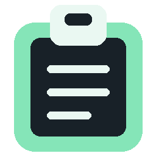

# ClipVault

A native **Rust** clipboard history for Windows 10/11 x64. Text, images, and files live in a compact popup beside a clipboard icon in your notification area.



## Install

Download **ClipVault-Setup-0.1.0-x64.exe** from [Releases](https://github.com/WitherBlitz/ClipVault/releases/tag/v0.1.0). The installer runs per user without administrator rights. A portable EXE and SHA256 checksums are also provided. Binaries are currently unsigned.

Windows may initially place the clipboard icon under the tray's overflow arrow. Drag it onto the taskbar notification area, or enable it in Windows taskbar settings. Applications cannot force Windows to keep a tray icon visible.

## Use

- Copy as usual. Click the clipboard tray icon or press **Ctrl+Shift+V**.
- Each page holds **10 items**. Use the left/right arrows for **10 pages**; only the newest **100 items** are retained. Empty pages are accessible.
- Click an item to restore it to your clipboard, then paste with **Ctrl+V**. Tab/Enter select items; Escape dismisses; left/right keys change pages.
- Right-click the tray icon, or click **•••**, for pause/resume, optional start at sign-in, clear history, or exit.
- Files and folders are saved as snapshots, regardless of extension. Recalling them supplies a normal Windows file list that Explorer and compatible apps can paste. A recalled cut operation becomes a copy, protecting the original files.

## Images and files

Clipboard PNG (including alpha), Windows DIB/DIBV5 bitmaps, JPEG/JFIF, GIF, TIFF, and WebP representations are preserved. Common images get thumbnails, with a checkerboard for transparency. Native bitmap clipboard content can be converted by Windows to DIB. Text preserves Unicode, HTML and RTF companion formats. The original captured payload is restored; thumbnails do not replace full-resolution images. Pasting into another application depends on the formats that application accepts.

File snapshots support ordinary local/network-accessible files and folders, without an extension allowlist or a per-file size cap. Snapshotting requires read access and enough free disk space. Links/junctions are rejected rather than followed, and a failed snapshot is reported without adding a partial history item. Save application-generated virtual files (for example, unsaved Outlook attachments) to disk before copying them. Application-private clipboard objects, OLE embedded documents and vector metafiles are not captured in this version. Clipboard-only virtual attachments are not represented as ordinary filesystem files.

## Local storage and privacy

There is **no networking, account, telemetry or cloud sync** in the app. History lives in `%LOCALAPPDATA%\ClipVault`. Text, image payloads, metadata and file snapshots are encrypted with Windows DPAPI for the current account. Windows history-exclusion flags and the `Clipboard Viewer Ignore` marker used by password managers are respected.

When you recall files, plaintext copies are materialized under `staging` inside the history directory, so other programs can paste them. These remain until their history item is evicted or cleared. Any process running as your account can access recalled files and can use DPAPI; this is protection at rest, not protection against malware running as you. An active large snapshot may finish after you pause. Very rapid clipboard changes can be missed when another application holds the clipboard locked or replaces its content before capture.

The 101st distinct captured item removes the oldest item and its file payloads. Consecutive identical text/image captures are coalesced; files are snapshotted again because their contents may have changed. File snapshots preserve names and bytes, not filesystem permissions, alternate data streams, or timestamps. Clearing history asks for confirmation. Uninstall leaves history intact; clear it from the app first if desired. Start-at-sign-in is opt-in.

## Build and verify

Requires the Rust stable MSVC x64 toolchain, Visual Studio C++ build tools/Windows SDK, and Inno Setup 6. The ICO and manifest are checked in; Python/Pillow is needed only to regenerate the icon.

```powershell
cargo fetch --locked
cargo fmt --check
cargo clippy --locked --all-targets -- -D warnings
cargo test --locked -- --test-threads=1
cargo build --locked --release
./scripts/package.ps1
```

The real clipboard integration tests temporarily use and restore supported clipboard content. Avoid copying during these tests. Other tests cover retention, native popup pagination/selection, encrypted restart, corrupt entries, file snapshots, snapshot integrity, locked-file eviction and PNG/DIBV5 alpha. CI runs these checks and uploads the installer and portable executable.

Version 0.1.0 is an initial preview release. Automated native UI and clipboard checks pass, but interactive desktop visual testing was interrupted. Test your normal copy/paste workflows before relying on its history as a backup.

For an isolated test instance: `clipvault.exe --data-dir C:\some\test-directory --show`. This uses a separate history and instance lock. Do not run it alongside another clipboard manager during clipboard testing.

## Native API references

The implementation follows Microsoft's [clipboard listener guidance](https://learn.microsoft.com/en-us/windows/win32/dataxchg/using-the-clipboard) and [Shell clipboard formats](https://learn.microsoft.com/en-us/windows/win32/shell/clipboard), particularly CF_HDROP and copy drop effects.

MIT licensed. Source: [WitherBlitz/ClipVault](https://github.com/WitherBlitz/ClipVault).
